# Baseline Padel: Backend

Magang Webdev Abinara 1 ITS, sesi Backend.

Pada sesi Frontend, Anda telah membangun tampilan Baseline Padel. Namun seluruh tombol "Booking" belum melakukan apa pun. Pada sesi ini, tombol tersebut akan benar-benar bekerja: data booking dikirim ke server, diperiksa, disimpan di database, lalu server mengirimkan jawaban kembali ke browser.

README ini disusun untuk peserta yang belum pernah mengerjakan backend. Bagian A menjelaskan konsep dasar yang dipakai sepanjang sesi. Bagian B berisi langkah praktik. Seluruh diagram tampil langsung di GitHub.

---

## Daftar isi

**Bagian A: Fundamental**

1. [Hasil akhir sesi ini](#1-hasil-akhir-sesi-ini)
2. [Gambaran besar: client, server, database](#2-gambaran-besar-client-server-database)
3. [HTTP: request dan response](#3-http-request-dan-response)
4. [Method: GET, POST, dan lainnya](#4-method-get-post-dan-lainnya)
5. [JSON](#5-json)
6. [Status code](#6-status-code)
7. [fetch(): cara browser mengirim request](#7-fetch-cara-browser-mengirim-request)
8. [Di mana kode berjalan di Next.js](#8-di-mana-kode-berjalan-di-nextjs)
9. [Peta cabang backend](#9-peta-cabang-backend)

**Bagian B: Praktik**

10. [Persiapan dan rundown](#10-persiapan-dan-rundown)
11. [Langkah 1: Halaman booking](#langkah-1-halaman-booking)
12. [Langkah 2: API route pertama](#langkah-2-api-route-pertama)
13. [Langkah 3: Validasi di server](#langkah-3-validasi-di-server)
14. [Langkah 4: Tabel di Supabase](#langkah-4-tabel-di-supabase)
15. [Langkah 5: Simpan ke database](#langkah-5-simpan-ke-database)
16. [Langkah 6: Menolak booking ganda](#langkah-6-menolak-booking-ganda)
17. [Langkah 7: Deploy ke Vercel](#langkah-7-deploy-ke-vercel)

**Penutup**

18. [Peta file](#18-peta-file)
19. [Masalah umum](#19-masalah-umum)
20. [Tugas](#20-tugas)
21. [Glosarium](#21-glosarium)

---

# Bagian A: Fundamental

## 1. Hasil akhir sesi ini

Sebuah halaman baru di alamat `/booking`. Pengunjung mengisi form, datanya tersimpan di database, lalu pengunjung menerima jawaban.

| Booking berhasil                            | Sesi sudah dibooking orang lain                   |
| ------------------------------------------- | ------------------------------------------------- |
|  | 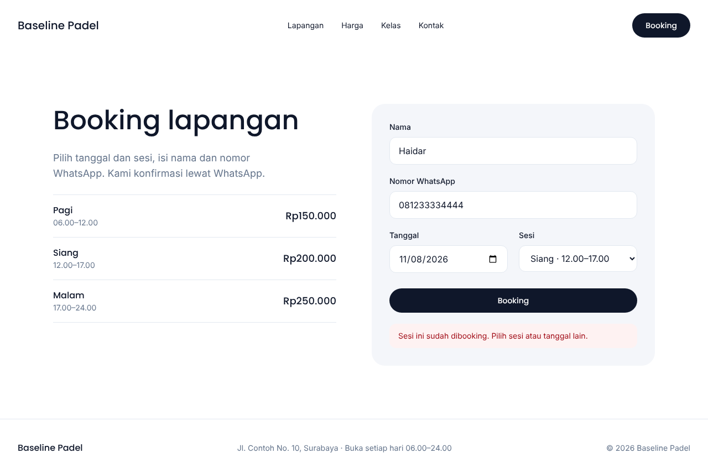 |

Urutan kejadian dari sudut pandang pengunjung:

| #   | Pengunjung melakukan                               | Yang terjadi di baliknya                                                               |
| --- | -------------------------------------------------- | -------------------------------------------------------------------------------------- |
| 1   | Menekan tombol "Booking Sekarang" di halaman utama | Browser berpindah ke halaman `/booking`                                                |
| 2   | Mengisi nama, nomor WhatsApp, tanggal, dan sesi    | Data masih berada di browser. Belum ada yang terkirim                                  |
| 3   | Menekan tombol "Booking"                           | Browser mengirim **request POST** berisi data tersebut ke `/api/booking`               |
| 4   | Menunggu sejenak                                   | Server memeriksa data. Jika valid, server menyimpannya ke tabel `bookings` di Supabase |
| 5   | Melihat kotak hijau atau merah                     | Server mengirim **response** berisi status code dan pesan. Browser menampilkannya      |

---

## 2. Gambaran besar: client, server, database

Setiap website yang "melakukan sesuatu" terdiri dari tiga bagian.

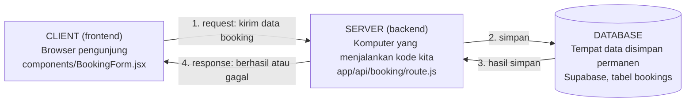

| Bagian       | Tugasnya                                             | Di project ini               | Analogi restoran               |
| ------------ | ---------------------------------------------------- | ---------------------------- | ------------------------------ |
| **Client**   | Menampilkan halaman dan mengirim permintaan          | `components/BookingForm.jsx` | Pelanggan yang menulis pesanan |
| **Server**   | Menerima permintaan, memeriksa, memutuskan, menjawab | `app/api/booking/route.js`   | Pelayan yang memeriksa pesanan |
| **Database** | Menyimpan data secara permanen                       | Tabel `bookings` di Supabase | Buku catatan pesanan di dapur  |

**Mengapa client tidak langsung menulis ke database?** Karena client berada di tangan pengunjung. Siapa pun dapat mengubah kode yang berjalan di browsernya. Jika client diberi akses langsung ke database, siapa pun juga dapat membaca, mengubah, atau menghapus seluruh data. Server adalah satu-satunya pihak yang kita kendalikan sepenuhnya. Oleh karena itu, semua akses ke database harus melalui server.

---

## 3. HTTP: request dan response

Client dan server berkomunikasi menggunakan **HTTP**. Polanya selalu sama: client mengirim satu **request**, server membalas dengan satu **response**.

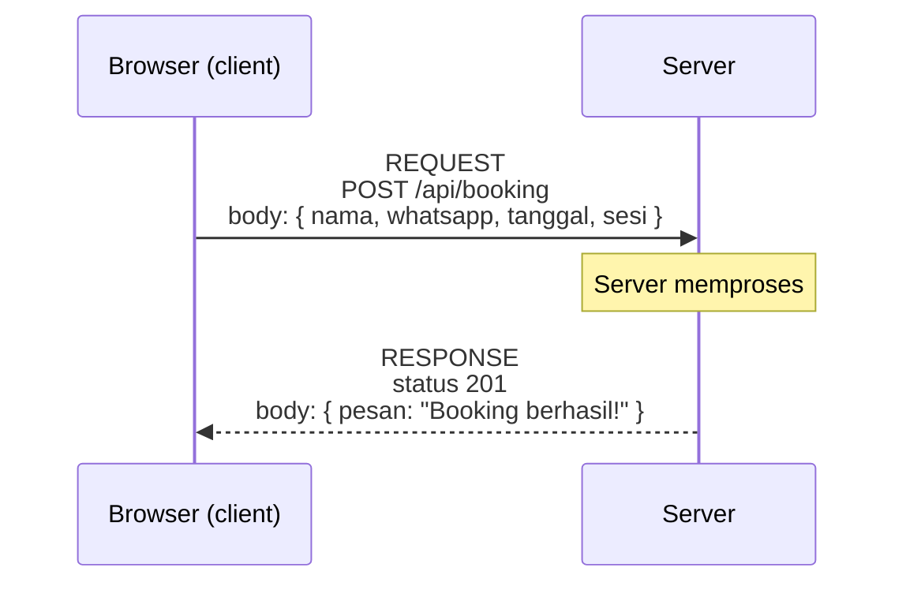

### 3.1 Isi sebuah request

Berikut contoh request yang dikirim saat pengunjung menekan tombol "Booking":

```http
POST /api/booking HTTP/1.1
Host: localhost:3000
Content-Type: application/json

{"nama":"Aura","whatsapp":"081211112222","tanggal":"2026-11-08","sesi":"siang"}
```

| Bagian             | Contoh                           | Artinya                                                        |
| ------------------ | -------------------------------- | -------------------------------------------------------------- |
| **Method**         | `POST`                           | Jenis permintaan. Dijelaskan di bagian 4                       |
| **URL / endpoint** | `/api/booking`                   | Alamat yang dituju di server                                   |
| **Header**         | `Content-Type: application/json` | Keterangan tambahan, di sini: "isi body berformat JSON"        |
| **Body**           | `{"nama":"Aura", ...}`           | Data yang dikirim. Hanya ada pada method tertentu seperti POST |

### 3.2 Isi sebuah response

```http
HTTP/1.1 201 Created
Content-Type: application/json

{"pesan":"Booking berhasil! Kami hubungi lewat WhatsApp."}
```

| Bagian          | Contoh                             | Artinya                                                    |
| --------------- | ---------------------------------- | ---------------------------------------------------------- |
| **Status code** | `201`                              | Ringkasan hasil dalam bentuk angka. Dijelaskan di bagian 6 |
| **Header**      | `Content-Type: application/json`   | Keterangan tambahan tentang isi response                   |
| **Body**        | `{"pesan":"Booking berhasil!..."}` | Data jawaban dari server                                   |

### 3.3 Melihat request secara langsung

Semua request dapat dilihat di browser: tekan **F12**, buka tab **Network**, lalu lakukan sesuatu di halaman. Klik salah satu baris untuk melihat detailnya.

| Tab di DevTools | Isinya                               |
| --------------- | ------------------------------------ |
| **Headers**     | Method, URL, status code, dan header |
| **Payload**     | Body yang **dikirim** browser        |
| **Response**    | Body yang **diterima** dari server   |

Biasakan membuka tab Network setiap kali sesuatu tidak berjalan. Sebagian besar masalah backend dapat dilacak dari sini.

---

## 4. Method: GET, POST, dan lainnya

Method memberi tahu server **apa yang ingin dilakukan** terhadap sebuah data.

| Method          | Tujuan                       | Memiliki body?   | Contoh di dunia nyata                   |
| --------------- | ---------------------------- | ---------------- | --------------------------------------- |
| `GET`           | Mengambil data               | Tidak            | Membuka halaman, melihat daftar booking |
| `POST`          | Membuat data baru            | Ya               | Mengirim form booking, mendaftar akun   |
| `PUT` / `PATCH` | Mengubah data yang sudah ada | Ya               | Mengganti jadwal booking                |
| `DELETE`        | Menghapus data               | Tidak (biasanya) | Membatalkan booking                     |

Empat operasi dasar terhadap data disebut **CRUD**. Setiap operasi memiliki pasangan method HTTP dan perintah SQL di database:

| CRUD       | Method HTTP     | Perintah SQL | Contoh                 |
| ---------- | --------------- | ------------ | ---------------------- |
| **C**reate | `POST`          | `INSERT`     | Booking baru           |
| **R**ead   | `GET`           | `SELECT`     | Melihat daftar booking |
| **U**pdate | `PUT` / `PATCH` | `UPDATE`     | Mengganti sesi booking |
| **D**elete | `DELETE`        | `DELETE`     | Membatalkan booking    |

Pada sesi ini kita hanya membuat **Create**: `POST` dari browser, `INSERT` ke database.

**Hal yang perlu diingat:** setiap kali Anda mengetik alamat di address bar dan menekan Enter, browser mengirim request `GET`. Inilah sebabnya membuka `http://localhost:3000/api/booking` langsung di browser akan menghasilkan error `405 Method Not Allowed`. Endpoint kita hanya menerima `POST`.

---

## 5. JSON

**JSON** (JavaScript Object Notation) adalah format teks untuk mengirim data antara client dan server. Bentuknya mirip object JavaScript. Perbedaannya, setiap nama properti wajib diapit tanda kutip ganda.

```json
{
  "nama": "Aura",
  "whatsapp": "081211112222",
  "tanggal": "2026-11-08",
  "sesi": "siang"
}
```

Data harus diubah menjadi teks sebelum dikirim, lalu diubah kembali menjadi object setelah diterima:

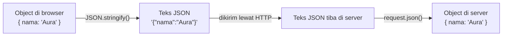

| Fungsi                 | Dipakai di                     | Kegunaan                               |
| ---------------------- | ------------------------------ | -------------------------------------- |
| `JSON.stringify(data)` | Browser, sebelum mengirim      | Object menjadi teks                    |
| `await request.json()` | Server, saat menerima          | Teks menjadi object                    |
| `Response.json(data)`  | Server, saat menjawab          | Object menjadi response berformat JSON |
| `await res.json()`     | Browser, saat menerima jawaban | Teks response menjadi object           |

---

## 6. Status code

Status code adalah angka tiga digit di setiap response. Angka ini memberi tahu client hasil permintaannya tanpa perlu membaca body.

| Kelompok | Arti umum             | Siapa yang salah    |
| -------- | --------------------- | ------------------- |
| `2xx`    | Berhasil              | Tidak ada           |
| `4xx`    | Permintaan bermasalah | Client (pengunjung) |
| `5xx`    | Server bermasalah     | Server (kita)       |

Status code yang dipakai pada sesi ini:

| Kode  | Nama                  | Kapan dikirim di project ini                                              |
| ----- | --------------------- | ------------------------------------------------------------------------- |
| `201` | Created               | Booking berhasil disimpan                                                 |
| `400` | Bad Request           | Data tidak valid, misalnya nama kosong atau nomor WhatsApp terlalu pendek |
| `404` | Not Found             | Alamat endpoint salah, misalnya nama file atau folder keliru              |
| `405` | Method Not Allowed    | Method tidak didukung, misalnya membuka endpoint POST lewat address bar   |
| `409` | Conflict              | Tanggal dan sesi tersebut sudah dibooking orang lain                      |
| `500` | Internal Server Error | Terjadi kesalahan di server, misalnya kunci database salah                |

---

## 7. fetch(): cara browser mengirim request

Di JavaScript, request dikirim menggunakan fungsi `fetch()`. Berikut anatomi `fetch()` yang akan dipakai di form booking:

```js
const res = await fetch("/api/booking", {
  // 1. alamat tujuan
  method: "POST", // 2. jenis request
  headers: { "Content-Type": "application/json" }, // 3. keterangan: body berformat JSON
  body: JSON.stringify(data), // 4. data yang dikirim, diubah menjadi teks
});

const hasil = await res.json(); // 5. body response, diubah menjadi object
console.log(res.status, res.ok, hasil); // 6. contoh: 201 true { pesan: "..." }
```

| Bagian       | Artinya                                                                                                                    |
| ------------ | -------------------------------------------------------------------------------------------------------------------------- |
| `await`      | Menunggu sampai server menjawab sebelum melanjutkan ke baris berikutnya. Request melalui jaringan selalu membutuhkan waktu |
| `async`      | Kata kunci yang wajib ditulis pada fungsi yang memakai `await`                                                             |
| `res.status` | Status code dari server, misalnya `201` atau `400`                                                                         |
| `res.ok`     | Bernilai `true` jika status code berada di kelompok `2xx`                                                                  |
| `res.json()` | Membaca body response dan mengubahnya menjadi object                                                                       |

Tanpa menulis `method`, `fetch()` akan mengirim `GET`. Itu sebabnya `method: "POST"` wajib ditulis saat mengirim data.

---

## 8. Di mana kode berjalan di Next.js

Next.js menampung frontend dan backend dalam satu project. Namun kodenya berjalan di dua tempat yang berbeda.

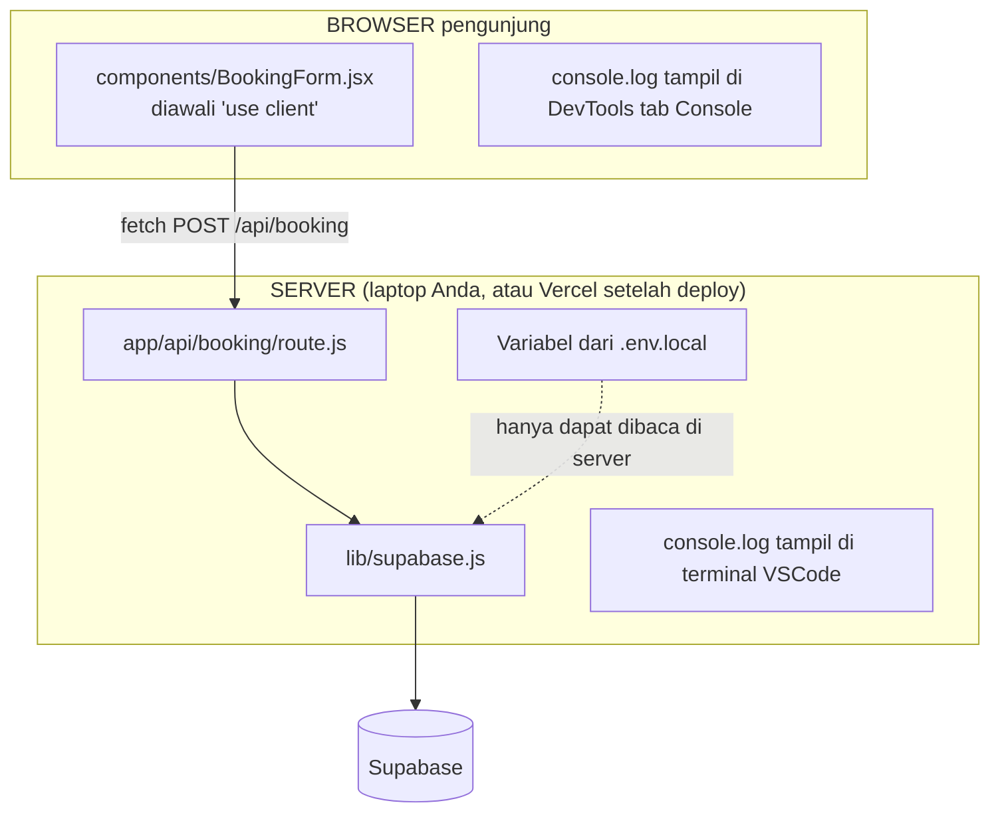

|                             | Browser (client)                        | Server                                      |
| --------------------------- | --------------------------------------- | ------------------------------------------- |
| File                        | Komponen dengan `"use client"`          | Semua file di `app/api/`, `lib/supabase.js` |
| Tempat `console.log` muncul | DevTools tab **Console**                | **Terminal** tempat `npm run dev` berjalan  |
| Dapat membaca `.env.local`? | Hanya variabel berawalan `NEXT_PUBLIC_` | Semua variabel                              |
| Dapat dilihat pengunjung?   | Ya. Seluruh kodenya dikirim ke browser  | Tidak                                       |

Aturan praktisnya: **apa pun yang rahasia harus berada di server.**

---

## 9. Peta cabang backend

Backend memiliki banyak cabang: login, contact form, middleware, payment, dan lain-lain. Seluruh cabang tersebut dibangun di atas fondasi yang sama, yaitu request, validasi, database, dan response. Sesi ini membangun fondasinya melalui cabang pertama.

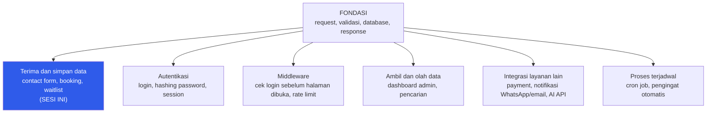

Sebagai contoh: login adalah "terima dan simpan data" ditambah pemeriksaan password. Middleware adalah "validasi" yang dijalankan sebelum sebuah halaman dibuka.

---

# Bagian B: Praktik

## 10. Persiapan dan rundown

### 10.1 Persiapan sebelum sesi (wajib)

1. Project `baseline-padel` dari sesi Frontend dapat dijalankan dengan `npm run dev`.
2. Buat akun di **supabase.com** (masuk menggunakan GitHub).
3. Klik **New project**. Nama: `baseline-padel`. Region: **Southeast Asia (Singapore)**. Simpan password database di catatan pribadi. Tunggu hingga project selesai dibuat (sekitar 2 menit).
4. Buat akun di **vercel.com** (masuk menggunakan GitHub).

### 10.2 Rundown

| Waktu | Kegiatan                         | Durasi   |
| ----- | -------------------------------- | -------- |
| 19.15 | Recap Frontend dan Bagian A      | 15 menit |
| 19.30 | Langkah 1: Halaman booking       | 15 menit |
| 19.45 | Langkah 2: API route pertama     | 10 menit |
| 19.55 | Langkah 3: Validasi di server    | 10 menit |
| 20.05 | Langkah 4: Tabel di Supabase     | 15 menit |
| 20.20 | Langkah 5: Simpan ke database    | 15 menit |
| 20.35 | Langkah 6: Menolak booking ganda | 10 menit |
| 20.45 | Langkah 7: Deploy ke Vercel      | 10 menit |
| 20.55 | Tugas dan tanya jawab            | 5 menit  |

Polanya sama dengan sesi Frontend: mentor menjelaskan satu bagian, Anda mengetik atau menyalin kodenya, lalu melakukan **Cek** di akhir setiap langkah.

> Jangan hanya menyalin kode. Setelah setiap langkah, buka DevTools tab **Network** dan perhatikan apa yang dikirim serta diterima.

---

## Langkah 1: Halaman booking

Langkah ini masih berupa frontend. Sebagian besar konsepnya telah dipelajari di sesi sebelumnya.

### 1a. Arahkan semua tombol Booking ke `/booking`

Komponen `Button` memiliki prop `href`. Ganti nilai `href` pada setiap tombol Booking menjadi `"/booking"`:

| File                    | Tombol                    |
| ----------------------- | ------------------------- |
| `components/Navbar.jsx` | Booking                   |
| `components/Hero.jsx`   | Booking Lapangan          |
| `components/Harga.jsx`  | Booking (di dalam `.map`) |
| `components/CTA.jsx`    | Booking Sekarang          |

Contoh:

```jsx
<Button variant="light" href="/booking">
  Booking Sekarang
</Button>
```

### 1b. Halaman `/booking`

Ingat aturan Next.js: **folder adalah alamat URL**. Buat file `app/booking/page.jsx` (folder `booking` baru di dalam `app/`):

```jsx
import BookingForm from "@/components/BookingForm";

export const metadata = { title: "Booking · Baseline Padel" };

const sessions = [
  { name: "Pagi", time: "06.00–12.00", price: "Rp150.000" },
  { name: "Siang", time: "12.00–17.00", price: "Rp200.000" },
  { name: "Malam", time: "17.00–24.00", price: "Rp250.000" },
];

export default function BookingPage() {
  return (
    <main className="mx-auto grid max-w-6xl gap-10 px-5 py-16 md:grid-cols-2 md:gap-16 md:px-8 md:py-24">
      <div className="flex flex-col gap-6">
        <h1 className="font-display text-4xl leading-tight font-medium md:text-5xl">
          Booking lapangan
        </h1>
        <p className="max-w-md text-base text-muted md:text-lg">
          Pilih tanggal dan sesi, isi nama dan nomor WhatsApp. Kami konfirmasi
          lewat WhatsApp.
        </p>
        <ul className="divide-y divide-line border-y border-line">
          {sessions.map((session) => (
            <li
              key={session.name}
              className="flex items-center justify-between py-4"
            >
              <div>
                <p className="font-display font-medium">{session.name}</p>
                <p className="text-sm text-muted">{session.time}</p>
              </div>
              <p className="font-display text-lg font-medium">
                {session.price}
              </p>
            </li>
          ))}
        </ul>
      </div>

      <BookingForm />
    </main>
  );
}
```

Navbar dan Footer akan muncul secara otomatis karena keduanya berada di `layout.jsx`.

### 1c. Form

Buat file `components/BookingForm.jsx`:

```jsx
"use client";

const inputClass =
  "rounded-xl border border-line bg-white px-4 py-3 text-base outline-none focus:border-ink";

export default function BookingForm() {
  function handleSubmit(e) {
    e.preventDefault();
    const data = Object.fromEntries(new FormData(e.currentTarget));
    console.log(data);
  }

  return (
    <form
      onSubmit={handleSubmit}
      className="flex flex-col gap-5 rounded-3xl bg-surface p-6 md:p-8"
    >
      <label className="flex flex-col gap-2">
        <span className="text-sm font-medium">Nama</span>
        <input
          name="nama"
          required
          placeholder="Nama lengkap"
          className={inputClass}
        />
      </label>

      <label className="flex flex-col gap-2">
        <span className="text-sm font-medium">Nomor WhatsApp</span>
        <input
          name="whatsapp"
          type="tel"
          required
          placeholder="08xxxxxxxxxx"
          className={inputClass}
        />
      </label>

      <div className="grid gap-5 md:grid-cols-2">
        <label className="flex flex-col gap-2">
          <span className="text-sm font-medium">Tanggal</span>
          <input name="tanggal" type="date" required className={inputClass} />
        </label>

        <label className="flex flex-col gap-2">
          <span className="text-sm font-medium">Sesi</span>
          <select name="sesi" required className={inputClass}>
            <option value="pagi">Pagi · 06.00–12.00</option>
            <option value="siang">Siang · 12.00–17.00</option>
            <option value="malam">Malam · 17.00–24.00</option>
          </select>
        </label>
      </div>

      <button
        type="submit"
        className="mt-2 rounded-full bg-ink px-6 py-3 font-display text-sm font-medium text-white"
      >
        Booking
      </button>
    </form>
  );
}
```

| Bagian kode               | Penjelasan                                                                                                         |
| ------------------------- | ------------------------------------------------------------------------------------------------------------------ |
| `"use client"`            | Komponen ini berjalan di **browser**, karena perlu merespons klik dan input pengunjung                             |
| `onSubmit={handleSubmit}` | Fungsi `handleSubmit` dipanggil saat form dikirim                                                                  |
| `e.preventDefault()`      | Mencegah perilaku bawaan browser, yaitu memuat ulang halaman saat form dikirim                                     |
| `new FormData(...)`       | Mengambil seluruh isi input berdasarkan atribut `name`                                                             |
| `Object.fromEntries(...)` | Mengubah isi form menjadi object, contoh: `{ nama: "Aura", sesi: "siang", ... }`                                   |
| `<button type="submit">`  | Tombol pengirim form. Komponen `Button` tidak dipakai karena `Button` merender `<a>` (tautan), bukan tombol submit |

**Cek:**

1. Klik "Booking Sekarang" di halaman utama. Halaman berpindah ke `/booking`.
2. Isi form, lalu klik **Booking**. Buka DevTools tab **Console**. Data form muncul di sana.

Data tersebut **masih berada di browser**. Jika halaman dimuat ulang, data hilang. Belum ada server yang menerimanya.

---

## Langkah 2: API route pertama

Di Next.js, kode server ditulis di dalam folder `app/api/`. Sama seperti halaman, **nama folder menjadi alamat endpoint**.

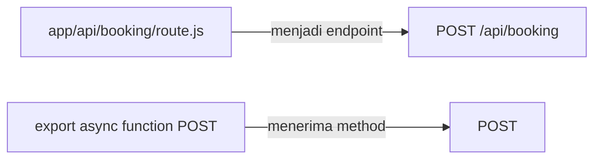

Buat file `app/api/booking/route.js`:

```js
export async function POST(request) {
  const data = await request.json();
  console.log("Data masuk ke server:", data);

  return Response.json({ pesan: "Server sudah menerima data" });
}
```

| Bagian kode                  | Penjelasan                                                                               |
| ---------------------------- | ---------------------------------------------------------------------------------------- |
| `export async function POST` | Nama fungsi menentukan method yang diterima. Fungsi bernama `POST` menerima request POST |
| `request.json()`             | Membaca body request dan mengubahnya dari teks JSON menjadi object                       |
| `console.log(...)`           | Mencetak ke **terminal**, karena kode ini berjalan di server                             |
| `Response.json(...)`         | Mengirim response berformat JSON. Status code bawaannya `200`                            |

Selanjutnya, di `components/BookingForm.jsx`, ganti fungsi `handleSubmit` saja:

```jsx
async function handleSubmit(e) {
  e.preventDefault();
  const data = Object.fromEntries(new FormData(e.currentTarget));

  const res = await fetch("/api/booking", {
    method: "POST",
    headers: { "Content-Type": "application/json" },
    body: JSON.stringify(data),
  });

  console.log(await res.json());
}
```

Perjalanan data pada langkah ini:

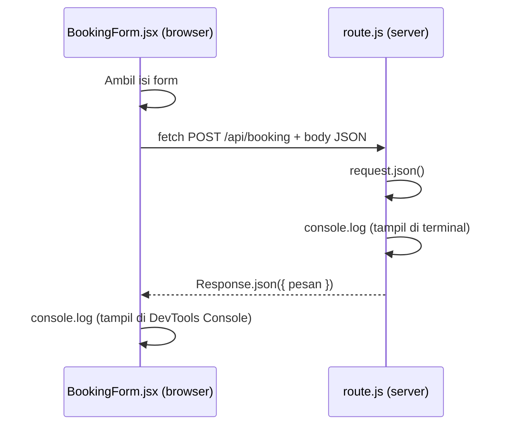

**Cek, di dua tempat:**

1. **Terminal VSCode** (tempat `npm run dev` berjalan): muncul `Data masuk ke server: {...}`. Ini adalah log dari **server**.
2. **DevTools tab Network**: klik baris `booking`. Tab **Payload** berisi data yang dikirim. Tab **Response** berisi jawaban server.

Log server muncul di terminal, bukan di browser. Ini membuktikan bahwa kedua kode berjalan di tempat yang berbeda.

**Uji tambahan:** buka `http://localhost:3000/api/booking` langsung di address bar. Browser mengirim `GET`, sedangkan file kita hanya memiliki fungsi `POST`. Hasilnya `405 Method Not Allowed`.

---

## Langkah 3: Validasi di server

Di DevTools tab **Console**, jalankan perintah berikut:

```js
fetch("/api/booking", {
  method: "POST",
  headers: { "Content-Type": "application/json" },
  body: JSON.stringify({ nama: "", sesi: "tengah malam" }),
});
```

Server tetap menerima data tersebut, meskipun nama kosong dan sesi tidak masuk akal. Atribut `required` di form **tidak melindungi apa pun**, karena siapa pun dapat mengirim request tanpa melalui form kita.

> **Aturan pertama backend: jangan pernah percaya data dari browser.** Validasi di frontend hanya membantu pengunjung. Validasi di server adalah yang benar-benar melindungi data.

Ganti seluruh isi `app/api/booking/route.js`:

```js
const SESI = ["pagi", "siang", "malam"];

export async function POST(request) {
  const body = await request.json().catch(() => null);
  if (!body) {
    return Response.json(
      { error: "Data harus berformat JSON" },
      { status: 400 },
    );
  }

  const nama = String(body.nama ?? "").trim();
  const whatsapp = String(body.whatsapp ?? "").replace(/\D/g, "");
  const tanggal = String(body.tanggal ?? "");
  const sesi = String(body.sesi ?? "");

  if (nama.length < 2) {
    return Response.json({ error: "Nama minimal 2 huruf" }, { status: 400 });
  }
  if (whatsapp.length < 10 || whatsapp.length > 15) {
    return Response.json(
      { error: "Nomor WhatsApp tidak valid" },
      { status: 400 },
    );
  }
  if (!/^\d{4}-\d{2}-\d{2}$/.test(tanggal)) {
    return Response.json({ error: "Tanggal tidak valid" }, { status: 400 });
  }
  if (!SESI.includes(sesi)) {
    return Response.json(
      { error: "Pilih sesi pagi, siang, atau malam" },
      { status: 400 },
    );
  }

  return Response.json(
    { pesan: "Data valid", data: { nama, whatsapp, tanggal, sesi } },
    { status: 201 },
  );
}
```

Cara kerja validasi ini dapat dibayangkan sebagai deretan penjaga. Data harus melewati semuanya:

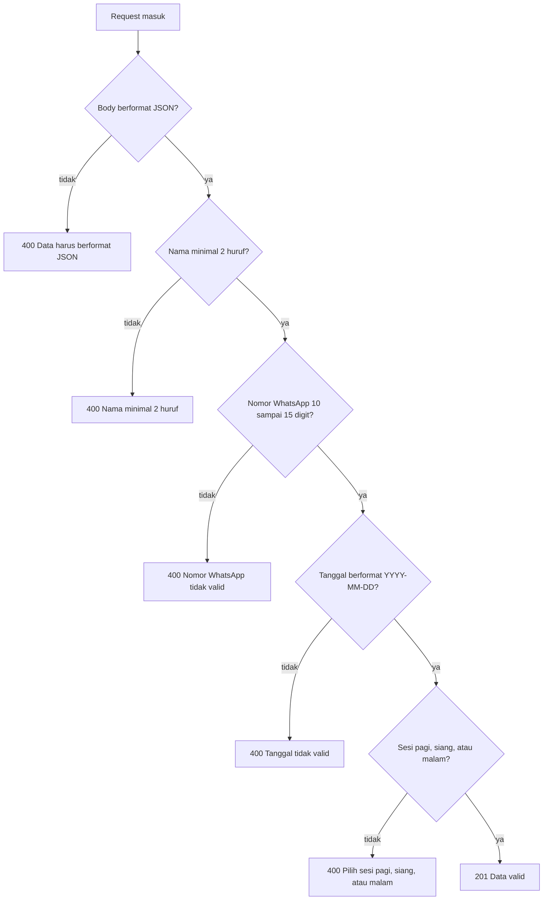

| Bagian kode               | Penjelasan                                                                     |
| ------------------------- | ------------------------------------------------------------------------------ |
| `.catch(() => null)`      | Jika body bukan JSON yang sah, hasilnya `null` sehingga server tidak error     |
| `String(body.nama ?? "")` | Jika `nama` tidak dikirim, gunakan string kosong, hasilnya selalu berupa teks  |
| `.trim()`                 | Menghapus spasi di awal dan akhir teks                                         |
| `.replace(/\D/g, "")`     | Menghapus semua karakter selain angka. `0812-3456-7890` menjadi `081234567890` |
| `/^\d{4}-\d{2}-\d{2}$/`   | Pola (regex) untuk format tanggal `2026-11-08`                                 |
| `SESI.includes(sesi)`     | Memastikan sesi termasuk salah satu dari tiga nilai yang diizinkan             |
| `return` di setiap `if`   | Begitu satu penjaga gagal, server langsung menjawab dan berhenti               |

**Cek:** jalankan kembali perintah `fetch` di atas. Di tab Network, status code sekarang **400** dan Response berisi `"Nama minimal 2 huruf"`.

> Log "Data masuk ke server" di terminal sekarang tidak muncul lagi. Hal ini normal karena seluruh isi file telah diganti dan versi baru tidak memiliki `console.log`. Yang tetap muncul di terminal adalah baris dari Next.js, contohnya `POST /api/booking 400`. Angka di baris tersebut adalah status code yang dikirim server.

---

## Langkah 4: Tabel di Supabase

**Supabase** adalah layanan database PostgreSQL yang dapat dipakai tanpa memasang server sendiri. Data disimpan dalam **tabel**, mirip sheet di Excel. Perbedaannya, setiap kolom memiliki aturan.

Bentuk tabel yang akan dibuat:

| id  | nama   | whatsapp     | tanggal    | sesi  | created_at       |
| --- | ------ | ------------ | ---------- | ----- | ---------------- |
| 1   | Aura   | 081211112222 | 2026-11-08 | siang | 2026-10-29 19:40 |
| 2   | Haidar | 081233334444 | 2026-11-09 | malam | 2026-10-29 19:42 |

Buka Supabase › menu kiri **SQL Editor** › **New query**. Tempel kode berikut, lalu klik **Run**:

```sql
create table bookings (
  id bigint generated always as identity primary key,
  nama text not null,
  whatsapp text not null,
  tanggal date not null,
  sesi text not null check (sesi in ('pagi', 'siang', 'malam')),
  created_at timestamptz not null default now()
);

alter table bookings enable row level security;
```

| Baris                         | Penjelasan                                                                  |
| ----------------------------- | --------------------------------------------------------------------------- |
| `create table bookings`       | Membuat tabel bernama `bookings`                                            |
| `id ... primary key`          | Nomor unik untuk setiap baris. Diisi otomatis oleh database                 |
| `text`, `date`, `timestamptz` | Tipe data: teks, tanggal, dan waktu lengkap dengan zona waktu               |
| `not null`                    | Kolom wajib diisi                                                           |
| `check (sesi in (...))`       | Database ikut menjaga. Kolom `sesi` hanya boleh berisi tiga nilai tersebut  |
| `default now()`               | Jika tidak diisi, kolom otomatis berisi waktu saat data disimpan            |
| `enable row level security`   | Mengunci tabel. Pihak luar tidak dapat membaca atau menulis secara langsung |

**Cek:** buka menu kiri **Table Editor**. Tabel `bookings` muncul dan masih kosong.

---

## Langkah 5: Simpan ke database

### 5a. Ambil kunci akses

Server membutuhkan dua informasi untuk terhubung ke Supabase:

| Informasi       | Lokasi di Supabase                                | Bentuk                                                                                                                             |
| --------------- | ------------------------------------------------- | ---------------------------------------------------------------------------------------------------------------------------------- |
| **Project URL** | Project Settings › **Data API**                   | `https://xxxx.supabase.co`, **tanpa** `/rest/v1/` di belakangnya. Jika yang tersalin mengandung `/rest/v1/`, hapus bagian tersebut |
| **Secret key**  | Project Settings › **API Keys** › klik **Reveal** | Diawali `sb_secret_`                                                                                                               |

> **Secret key adalah kunci utama.** Siapa pun yang memilikinya dapat membaca, mengubah, dan menghapus **seluruh** data. Jangan menulisnya di kode, jangan mengirimnya di grup, dan jangan menampilkannya saat berbagi layar.

### 5b. Simpan di `.env.local`

Buat file `.env.local` di root project (sejajar dengan `package.json`):

```bash
SUPABASE_URL=https://xxxx.supabase.co
SUPABASE_SECRET_KEY=sb_secret_xxxxxxxx
```

Setelah itu, **restart** server: tekan Ctrl+C di terminal, lalu jalankan `npm run dev` kembali. File `.env.local` hanya dibaca saat server mulai.

Ke mana saja kunci ini boleh berada:

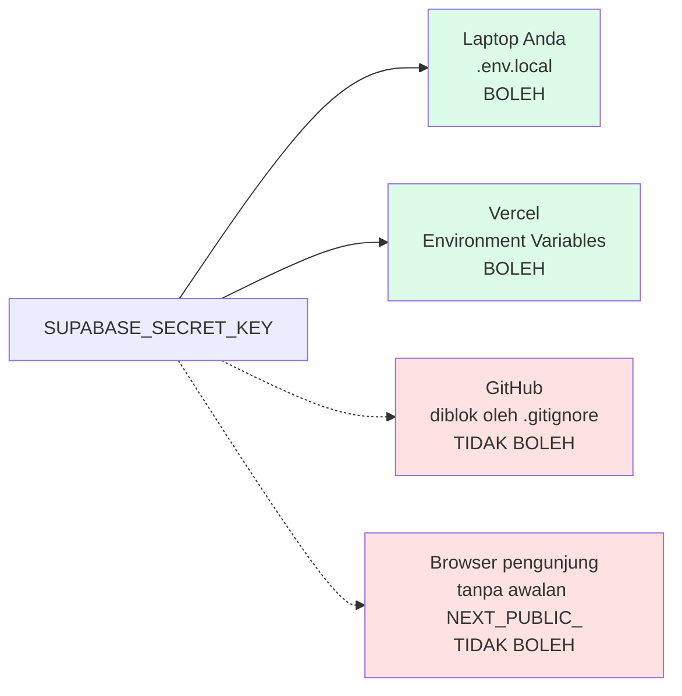

Dua aturan penting:

1. **Nama variabel tidak diawali `NEXT_PUBLIC_`.** Next.js memasukkan variabel berawalan `NEXT_PUBLIC_` ke dalam JavaScript yang dikirim ke browser. Siapa pun dapat melihatnya melalui DevTools. Variabel tanpa awalan tersebut hanya dapat dibaca oleh kode server. Jika secret key diberi nama `NEXT_PUBLIC_SUPABASE_SECRET_KEY`, setiap pengunjung website dapat mengambilnya.
2. **`.env.local` tidak boleh masuk Git.** Jalankan `git status`. File `.env.local` **tidak boleh** muncul di daftar. Jika muncul, berhenti dan hubungi mentor.

**Bukti sederhana:** tambahkan sementara baris berikut di dalam fungsi `BookingForm` (komponen client):

```jsx
console.log(process.env.SUPABASE_SECRET_KEY);
```

Hasilnya di DevTools Console adalah `undefined`. Kunci tersebut tidak pernah sampai ke browser. Hapus kembali baris tersebut setelah dicoba.

### 5c. Hubungkan ke Supabase

Pasang library Supabase:

```bash
npm install @supabase/supabase-js
```

Buat folder `lib/` di root project (sejajar dengan `app/` dan `components/`), lalu buat file `lib/supabase.js`:

```js
import { createClient } from "@supabase/supabase-js";

// Hanya boleh dipakai di server (app/api/...), karena memakai secret key.
export function supabaseServer() {
  return createClient(
    process.env.SUPABASE_URL,
    process.env.SUPABASE_SECRET_KEY,
    {
      auth: { persistSession: false },
    },
  );
}
```

| Bagian kode                | Penjelasan                                                                                   |
| -------------------------- | -------------------------------------------------------------------------------------------- |
| `createClient(url, key)`   | Membuat "penghubung" ke project Supabase                                                     |
| `process.env.SUPABASE_URL` | Membaca nilai dari `.env.local`                                                              |
| `persistSession: false`    | Server tidak perlu menyimpan sesi login. Fitur tersebut untuk aplikasi dengan login pengguna |

### 5d. Simpan datanya

Ganti seluruh isi `app/api/booking/route.js`:

```js
import { supabaseServer } from "@/lib/supabase";

const SESI = ["pagi", "siang", "malam"];

export async function POST(request) {
  const body = await request.json().catch(() => null);
  if (!body) {
    return Response.json(
      { error: "Data harus berformat JSON" },
      { status: 400 },
    );
  }

  const nama = String(body.nama ?? "").trim();
  const whatsapp = String(body.whatsapp ?? "").replace(/\D/g, "");
  const tanggal = String(body.tanggal ?? "");
  const sesi = String(body.sesi ?? "");

  if (nama.length < 2) {
    return Response.json({ error: "Nama minimal 2 huruf" }, { status: 400 });
  }
  if (whatsapp.length < 10 || whatsapp.length > 15) {
    return Response.json(
      { error: "Nomor WhatsApp tidak valid" },
      { status: 400 },
    );
  }
  if (!/^\d{4}-\d{2}-\d{2}$/.test(tanggal)) {
    return Response.json({ error: "Tanggal tidak valid" }, { status: 400 });
  }
  if (!SESI.includes(sesi)) {
    return Response.json(
      { error: "Pilih sesi pagi, siang, atau malam" },
      { status: 400 },
    );
  }

  const supabase = supabaseServer();
  const { error } = await supabase
    .from("bookings")
    .insert({ nama, whatsapp, tanggal, sesi });

  if (error) {
    console.error(error);
    return Response.json(
      { error: "Server sedang bermasalah, coba lagi nanti" },
      { status: 500 },
    );
  }

  return Response.json(
    { pesan: "Booking berhasil! Kami hubungi lewat WhatsApp." },
    { status: 201 },
  );
}
```

Bagian validasi tidak berubah. Yang baru hanya bagian bawah:

| Bagian kode                 | Penjelasan                                                                |
| --------------------------- | ------------------------------------------------------------------------- |
| `supabase.from("bookings")` | Memilih tabel `bookings`                                                  |
| `.insert({ ... })`          | Menambah satu baris baru. Setara dengan perintah SQL `INSERT`             |
| `const { error } = ...`     | Supabase mengembalikan `error`, nilainya kosong jika penyimpanan berhasil |
| `console.error(error)`      | Detail error dicetak di terminal untuk kita, bukan dikirim ke pengunjung  |
| `status: 500`               | Kesalahan terjadi di sisi server. Pengunjung hanya menerima pesan umum    |
| `status: 201`               | Data berhasil dibuat                                                      |

### 5e. Tampilkan hasilnya di form

Ganti seluruh isi `components/BookingForm.jsx`:

```jsx
"use client";

import { useState } from "react";

const inputClass =
  "rounded-xl border border-line bg-white px-4 py-3 text-base outline-none focus:border-ink";

export default function BookingForm() {
  const [status, setStatus] = useState("idle");
  const [pesan, setPesan] = useState("");

  async function handleSubmit(e) {
    e.preventDefault();
    const form = e.currentTarget;
    const data = Object.fromEntries(new FormData(form));

    setStatus("loading");
    try {
      const res = await fetch("/api/booking", {
        method: "POST",
        headers: { "Content-Type": "application/json" },
        body: JSON.stringify(data),
      });
      const hasil = await res.json();

      if (res.ok) {
        setStatus("berhasil");
        setPesan(hasil.pesan);
        form.reset();
      } else {
        setStatus("gagal");
        setPesan(hasil.error);
      }
    } catch {
      setStatus("gagal");
      setPesan("Koneksi bermasalah, coba lagi");
    }
  }

  return (
    <form
      onSubmit={handleSubmit}
      className="flex flex-col gap-5 rounded-3xl bg-surface p-6 md:p-8"
    >
      <label className="flex flex-col gap-2">
        <span className="text-sm font-medium">Nama</span>
        <input
          name="nama"
          required
          placeholder="Nama lengkap"
          className={inputClass}
        />
      </label>

      <label className="flex flex-col gap-2">
        <span className="text-sm font-medium">Nomor WhatsApp</span>
        <input
          name="whatsapp"
          type="tel"
          required
          placeholder="08xxxxxxxxxx"
          className={inputClass}
        />
      </label>

      <div className="grid gap-5 md:grid-cols-2">
        <label className="flex flex-col gap-2">
          <span className="text-sm font-medium">Tanggal</span>
          <input name="tanggal" type="date" required className={inputClass} />
        </label>

        <label className="flex flex-col gap-2">
          <span className="text-sm font-medium">Sesi</span>
          <select name="sesi" required className={inputClass}>
            <option value="pagi">Pagi · 06.00–12.00</option>
            <option value="siang">Siang · 12.00–17.00</option>
            <option value="malam">Malam · 17.00–24.00</option>
          </select>
        </label>
      </div>

      <button
        type="submit"
        disabled={status === "loading"}
        className="mt-2 rounded-full bg-ink px-6 py-3 font-display text-sm font-medium text-white disabled:opacity-50"
      >
        {status === "loading" ? "Mengirim..." : "Booking"}
      </button>

      {status === "berhasil" && (
        <p className="rounded-xl bg-green-50 px-4 py-3 text-sm text-green-800">
          {pesan}
        </p>
      )}
      {status === "gagal" && (
        <p className="rounded-xl bg-red-50 px-4 py-3 text-sm text-red-800">
          {pesan}
        </p>
      )}
    </form>
  );
}
```

| Bagian kode                       | Penjelasan                                                                                                |
| --------------------------------- | --------------------------------------------------------------------------------------------------------- |
| `useState("idle")`                | Menyimpan status form: `idle`, `loading`, `berhasil`, atau `gagal`. Tampilan berubah mengikuti status ini |
| `disabled={status === "loading"}` | Tombol dinonaktifkan selama menunggu jawaban, sehingga tidak dapat ditekan dua kali                       |
| `res.ok`                          | Bernilai `true` untuk status `2xx`. Menentukan kotak hijau atau merah                                     |
| `try { ... } catch { ... }`       | Menangani kondisi ketika request gagal terkirim sama sekali, misalnya koneksi terputus                    |
| `form.reset()`                    | Mengosongkan form setelah booking berhasil                                                                |

Perjalanan lengkap satu booking:

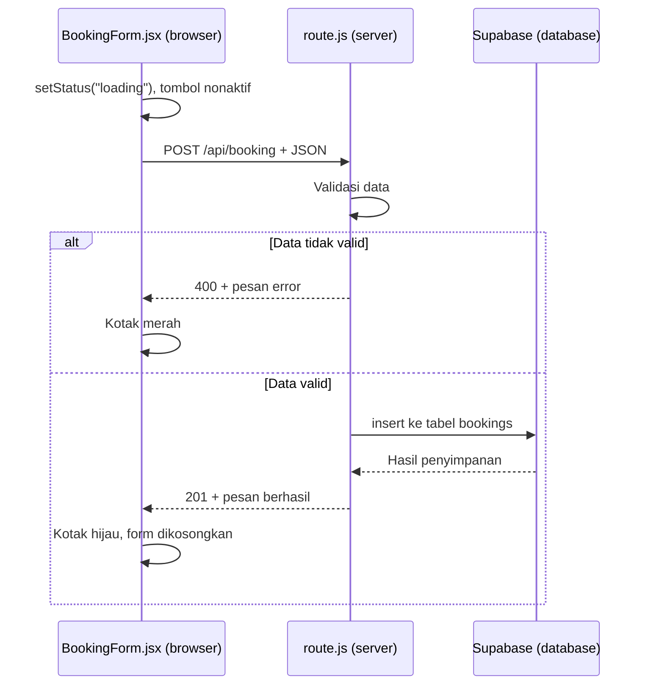

**Cek:**

1. Isi form dengan benar. Muncul kotak hijau.
2. Buka Supabase **Table Editor** › `bookings`. Data Anda tersimpan di sana dan tetap ada walaupun browser dimuat ulang atau ditutup.
3. Isi nomor WhatsApp dengan `123`. Muncul kotak merah "Nomor WhatsApp tidak valid".

---

## Langkah 6: Menolak booking ganda

Satu sesi pada satu tanggal hanya boleh dibooking satu kali. Coba booking tanggal dan sesi yang sama dua kali. Keduanya masuk ke tabel. Ini adalah bug.

Di Supabase **SQL Editor**, jalankan:

```sql
alter table bookings add constraint slot_unik unique (tanggal, sesi);
```

> Jika muncul error karena sudah ada data ganda, hapus salah satunya di Table Editor, lalu jalankan kembali perintah di atas.

Sekarang database menolak kombinasi tanggal dan sesi yang sama. Namun pengunjung menerima pesan "Server sedang bermasalah", padahal kesalahannya bukan di server.

Di `app/api/booking/route.js`, tambahkan kode berikut **tepat di atas** baris `if (error) {`:

```js
if (error?.code === "23505") {
  return Response.json(
    { error: "Sesi ini sudah dibooking. Pilih sesi atau tanggal lain." },
    { status: 409 },
  );
}
```

`23505` adalah kode error PostgreSQL untuk "data ini sudah ada" (unique violation). Kode tersebut diterjemahkan menjadi status `409` dan pesan yang dapat dipahami pengunjung.

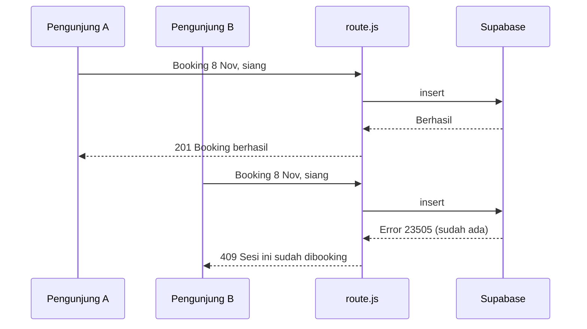

**Cek:** booking tanggal dan sesi yang sama dua kali. Booking kedua menampilkan kotak merah "Sesi ini sudah dibooking". Di tab Network, status code-nya **409**.

**Mengapa penjaganya di database, bukan di kode?** Jika dua pengunjung menekan tombol pada detik yang sama, pemeriksaan di kode dapat terlewati. Pemeriksaan `unique` di database tidak.

---

## Langkah 7: Deploy ke Vercel

Website yang hanya berjalan di laptop belum dapat dipakai siapa pun. Vercel menjalankan server Next.js kita di internet.

```bash
git add .
git commit -m "Booking tersambung ke Supabase"
git push
```

1. Periksa halaman repo di GitHub. File `.env.local` **tidak boleh ada**.
2. Buka **vercel.com** › **Add New** › **Project** › pilih repo `baseline-padel` › **Import**.
3. Sebelum menekan Deploy, buka **Environment Variables** dan isi `SUPABASE_URL` serta `SUPABASE_SECRET_KEY` dengan nilai yang sama persis dengan `.env.local`.
4. Klik **Deploy**.

> Jika project sudah pernah di-deploy: buka project › **Settings** › **Environment Variables** › tambahkan kedua variabel › tab **Deployments** › titik tiga pada deploy terakhir › **Redeploy**.

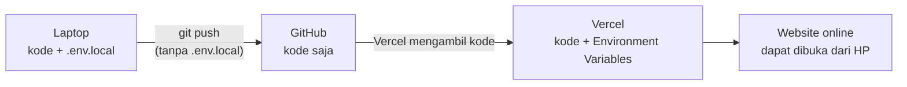

**Cek:** buka link Vercel dari HP, lakukan satu booking, lalu pastikan datanya muncul di Supabase.

Jika muncul error 500 di Vercel padahal di laptop berjalan normal, hampir pasti environment variable di Vercel belum diisi atau salah ketik. Periksa melalui Vercel › project › **Logs**.

---

# Penutup

## 18. Peta file

File yang dibuat atau diubah pada sesi ini:

```
baseline-padel/
  app/
    api/booking/route.js   Server: menerima POST, validasi, simpan ke Supabase, jawab   (BARU)
    booking/page.jsx       Halaman /booking: judul, daftar harga, form                   (BARU)
    layout.jsx             Navbar dan Footer; tidak diubah
  components/
    BookingForm.jsx        Form di browser: kirim fetch, tampilkan hasil                 (BARU)
    Navbar.jsx, Hero.jsx,
    Harga.jsx, CTA.jsx     href tombol Booking diganti menjadi "/booking"                (DIUBAH)
  lib/
    supabase.js            Penghubung ke Supabase, hanya dipakai di server               (BARU)
  .env.local               SUPABASE_URL dan SUPABASE_SECRET_KEY; tidak masuk Git          (BARU)
```

**Urutan membaca kode:** `components/BookingForm.jsx` › `app/api/booking/route.js` › `lib/supabase.js`. Urutan ini sama dengan perjalanan data.

---

## 19. Masalah umum

| Gejala                                                                   | Penyebab                                                                              | Solusi                                                                     |
| ------------------------------------------------------------------------ | ------------------------------------------------------------------------------------- | -------------------------------------------------------------------------- |
| Klik Booking, halaman dimuat ulang, Console kosong                       | `e.preventDefault()` tidak ditulis                                                    | Periksa baris pertama `handleSubmit`                                       |
| `404` di tab Network untuk `/api/booking`                                | Nama file atau folder salah, misalnya `routes.js`                                     | Harus persis `app/api/booking/route.js`                                    |
| `405 Method Not Allowed`                                                 | Nama fungsi bukan `POST` dengan huruf kapital, atau endpoint dibuka lewat address bar | Tulis `export async function POST`                                         |
| Selalu `500` setelah Langkah 5                                           | `.env.local` belum diisi atau server belum di-restart                                 | Ctrl+C, lalu `npm run dev` kembali                                         |
| `500`, terminal menampilkan `supabaseUrl is required`                    | Nama variabel di `.env.local` berbeda dengan di kode                                  | Samakan: `SUPABASE_URL`, `SUPABASE_SECRET_KEY`                             |
| `500`, terminal menampilkan `Could not find the table 'public.bookings'` | SQL Langkah 4 belum dijalankan                                                        | Jalankan di SQL Editor                                                     |
| `500` terus, padahal tabel sudah ada                                     | `SUPABASE_URL` mengandung `/rest/v1/`                                                 | Hapus `/rest/v1/`, sisakan `https://xxxx.supabase.co`, lalu restart server |
| Booking ganda tetap masuk                                                | SQL Langkah 6 belum dijalankan                                                        | Jalankan perintah `alter table ... unique`                                 |
| `.env.local` muncul di `git status`                                      | `.gitignore` terhapus atau diubah                                                     | Pastikan `.gitignore` berisi baris `.env*`                                 |
| Error 500 hanya di Vercel                                                | Environment variable di Vercel belum diisi                                            | Isi di Settings, lalu Redeploy                                             |

---

## 20. Tugas

**Sambungkan CTA form di website showcase produk Anda** (tugas UI/UX dan Frontend) ke database, dengan pola yang sama:

1. Tabel `waitlist` di Supabase dengan kolom `id`, `nama`, `email`, `created_at`. Kolom `email` wajib `unique`.
2. API route `app/api/waitlist/route.js` dengan validasi: nama minimal 2 huruf dan email harus mengandung `@`.
3. Email yang sudah terdaftar dijawab dengan status `409` dan pesan yang jelas.
4. Form menampilkan status loading, berhasil, dan gagal.
5. Deploy ke Vercel. Environment variable diisi di dashboard.

**Kumpulkan:** link Vercel dan link repo di grup, beserta screenshot Table Editor yang berisi minimal 3 data.

**Checklist sebelum mengumpulkan:**

- [ ] `.env.local` tidak ada di repo GitHub
- [ ] Mengirim data tidak valid melalui Console menghasilkan `400`
- [ ] Mengirim email yang sama dua kali menghasilkan `409`
- [ ] Form berjalan dari HP melalui link Vercel

**Bonus (Baseline Padel):** tolak booking untuk tanggal yang sudah lewat. Petunjuk: bandingkan `tanggal` dengan `new Date().toISOString().slice(0, 10)` di server.

---

## 21. Glosarium

| Istilah                      | Arti sederhana                                                                             |
| ---------------------------- | ------------------------------------------------------------------------------------------ |
| **Frontend / client**        | Bagian website yang berjalan di browser pengunjung                                         |
| **Backend / server**         | Bagian website yang berjalan di komputer kita. Pengunjung tidak dapat melihat kodenya      |
| **Database**                 | Tempat menyimpan data secara permanen                                                      |
| **HTTP**                     | Aturan komunikasi antara browser dan server                                                |
| **Request**                  | Pesan dari client ke server                                                                |
| **Response**                 | Jawaban dari server ke client                                                              |
| **Endpoint**                 | Alamat di server yang menerima request, contoh: `/api/booking`                             |
| **API**                      | Kumpulan endpoint yang dapat dipanggil oleh program lain                                   |
| **Method**                   | Jenis request: `GET`, `POST`, `PUT`, `PATCH`, `DELETE`                                     |
| **Header**                   | Keterangan tambahan pada request atau response                                             |
| **Body**                     | Isi data pada request atau response                                                        |
| **JSON**                     | Format teks untuk mengirim data. Mirip object JavaScript                                   |
| **Status code**              | Angka yang meringkas hasil request. `2xx` berhasil, `4xx` salah client, `5xx` salah server |
| **fetch()**                  | Fungsi JavaScript untuk mengirim request dari browser                                      |
| **async / await**            | Cara menulis kode yang menunggu proses lambat, seperti request jaringan                    |
| **CRUD**                     | Create, Read, Update, Delete: empat operasi dasar terhadap data                            |
| **SQL**                      | Bahasa untuk memberi perintah ke database                                                  |
| **Tabel / kolom / baris**    | Tabel seperti satu sheet. Kolom adalah jenis data. Baris adalah satu entri                 |
| **Primary key**              | Kolom berisi nilai unik untuk setiap baris, di sini `id`                                   |
| **Constraint**               | Aturan di database, misalnya `not null`, `check`, `unique`                                 |
| **Validasi**                 | Pemeriksaan bahwa data masuk akal sebelum diproses                                         |
| **Environment variable**     | Nilai konfigurasi atau rahasia yang disimpan di luar kode                                  |
| **Secret key**               | Kunci dengan akses penuh ke database. Hanya boleh berada di server                         |
| **RLS (Row Level Security)** | Fitur Supabase untuk mengunci tabel dari akses langsung                                    |
| **Deploy**                   | Menjalankan website di internet agar dapat diakses publik                                  |
